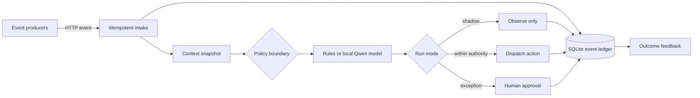

# SignalRoom

**Ambient agents, accountable outcomes.**

SignalRoom is an open-source control room for agents that begin with an event rather than a chat prompt. It demonstrates a complete event-to-outcome path:

```text
event → context snapshot → policy check → agent action → human exception → outcome → feedback
```

The working prototype includes a durable SQLite event ledger, duplicate-event suppression, three autonomy modes, approval and rejection flows, replayable traces, outcome feedback, and an optional local Qwen model through Ollama. It has no required Python packages or paid APIs.

## Why this exists

Agents are becoming less dependent on human initiation. That should not make them less accountable to human policy.

SignalRoom treats the model as one probabilistic component inside a deterministic operating path. Policy remains in code. Risky or irreversible actions cross a visible authority boundary. Every decision—including “observe only”—is stored as an event record.

This is intentionally not another chat interface or general-purpose agent framework. It is a small proving ground for a harder question: **did this event deserve an intervention, and can we prove the intervention helped?**

## Run it

Requirements: Python 3.9 or newer.

```bash
python3 server.py
```

Open [http://127.0.0.1:4173](http://127.0.0.1:4173).

The default uses a transparent deterministic decision engine, so the demo works immediately and offline.

### Use a fully local model

[Qwen3-4B](https://huggingface.co/Qwen/Qwen3-4B) is distributed under Apache 2.0. Run it locally with [Ollama](https://github.com/ollama/ollama):

```bash
ollama pull qwen3:4b
SIGNALROOM_MODEL=ollama OLLAMA_MODEL=qwen3:4b python3 server.py
```

Optional environment variables:

| Variable | Default | Purpose |
| --- | --- | --- |
| `SIGNALROOM_MODEL` | `rules` | Set to `ollama` to use a local model |
| `OLLAMA_MODEL` | `qwen3:4b` | Local Ollama model name |
| `OLLAMA_URL` | `http://127.0.0.1:11434/api/chat` | Ollama chat endpoint |

If Ollama is unavailable, SignalRoom safely falls back to the transparent rules engine and records that fallback in the decision.

## What to try

1. Open a seeded event and inspect its event-to-outcome trace.
2. Rate the recommendation as useful or noise. The shadow score updates immediately.
3. Switch from **Shadow** to **Guarded** mode and inject a medium-risk event. It will pause for approval.
4. Switch to **Autonomous** mode and inject a low-risk document event. It will act within delegated authority.
5. Submit the same event ID through the API twice. The second delivery returns the original event instead of causing a second action.

Example event:

```bash
curl -X POST http://127.0.0.1:4173/api/events \
  -H 'content-type: application/json' \
  -d '{
    "id": "evt_demo_001",
    "type": "workflow.stalled",
    "source": "finance.close",
    "summary": "Month-end reconciliation is 61 minutes past its SLA",
    "payload": {"workflow": "close", "stalled_minutes": 61}
  }'
```

## Architecture



The model recommends; the policy layer decides whether that recommendation may become an action. This separation is the core design choice.

## API

| Method | Path | Description |
| --- | --- | --- |
| `GET` | `/api/events` | List the event ledger |
| `POST` | `/api/events` | Ingest and evaluate an event |
| `GET` | `/api/events/:id` | Read one complete event record |
| `POST` | `/api/events/:id/approve` | Approve a pending action |
| `POST` | `/api/events/:id/reject` | Reject a pending action |
| `POST` | `/api/events/:id/feedback` | Mark an intervention useful or noisy |
| `POST` | `/api/config` | Set `shadow`, `guarded`, or `autonomous` mode |
| `GET` | `/api/metrics` | Read the shadow-mode scorecard |

## Tests

```bash
python3 -m unittest discover -s tests -v
```

## Design notes

- **Shadow is the default.** A new deployment should earn the right to cause side effects.
- **Idempotency comes before intelligence.** Duplicate delivery must not become duplicate action.
- **Context is a timestamped snapshot.** The event alone is rarely enough to justify action.
- **Authority is explicit.** Risk and reversibility determine when a person becomes necessary.
- **Silence is measurable.** “No side effect” is preserved as an outcome, not lost as missing data.
- **Feedback closes the loop.** Utility and false interruption matter more than raw agent activity.

## Research signals

SignalRoom was inspired by converging platform and research patterns:

- [AWS: ambient agents from event-driven signals to human-in-the-loop workflows](https://aws.amazon.com/blogs/machine-learning/building-ambient-agents-with-amazon-bedrock-agentcore-from-event-driven-signals-to-human-in-the-loop-workflows/)
- [OpenAI: agent session lifecycle webhooks](https://developers.openai.com/api/docs/guides/agents-api/sessions/webhooks)
- [MLflow: event-driven agent architecture and production operations](https://mlflow.org/articles/event-driven-agents/)
- [Autonomous Event-Driven Multi-Agent Orchestration for Enterprise AI at Scale](https://arxiv.org/abs/2606.20058)

The companion essay is available as [BLOG.md](BLOG.md) and inside the running app at `/blog.html`.

## License

Apache License 2.0. See [LICENSE](LICENSE).
