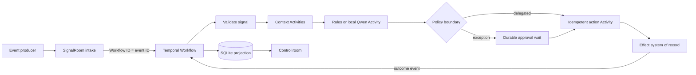

# SignalRoom

**Ambient agents, durable execution, accountable outcomes.**

SignalRoom is an open-source control room for agents that begin with an event instead of a chat prompt. Each event becomes a durable Temporal Workflow:

```text
event → validation → context → policy → proposed action → human exception
      → execution result → business outcome → feedback
```

The important distinction is that an agent recommendation is not an outcome. SignalRoom records three separate facts:

1. **Decision:** what the agent recommended and why.
2. **Execution:** whether an idempotent side effect actually occurred.
3. **Business outcome:** what changed afterward, according to the source system.

## What is durable

Temporal owns workflow execution state. If a Worker stops during context gathering, approval or outcome observation, another Worker reconstructs the case from Event History and resumes at the unfinished step. Completed model calls and Activities are not repeated during replay.

SQLite is the UI projection and analytics store. The downstream system remains the source of truth for real-world effects. This separation prevents a model response from being mistaken for a completed business result.

The implementation includes:

- Temporal Workflow per event, with Workflow-ID deduplication
- Durable human approval and outcome waits
- Idempotent action Activities with stable effect references
- Explicit outcome contracts for every supported signal
- Signal type/description conflict detection
- Shadow, guarded and autonomous modes
- Optional local Qwen3-4B inference through Ollama
- Local fallback mode when Temporal is unavailable
- Replayable UI trace and outcome scorecard

## Quick start

Requirements:

- Docker-compatible runtime
- [uv](https://github.com/astral-sh/uv)

```bash
chmod +x scripts/dev.sh
./scripts/dev.sh
```

Open:

- SignalRoom: [http://127.0.0.1:4173](http://127.0.0.1:4173)
- Temporal Web UI: [http://127.0.0.1:8233](http://127.0.0.1:8233)

The script starts the local Temporal development service, installs the locked Python environment, starts a Temporal Worker and runs the SignalRoom server. Stop SignalRoom with `Ctrl-C`. The Temporal container remains available for the next run.

If an older SignalRoom server is still using port 4173, stop it with `Ctrl-C` before starting this version.

### Run the processes separately

```bash
docker run -d --name signalroom-temporal \
  -p 7233:7233 -p 8233:8233 \
  temporalio/temporal:latest server start-dev --ip 0.0.0.0

uv sync
uv run python worker.py
```

In another terminal:

```bash
uv run python server.py
```

### Use a fully local model

[Qwen3-4B](https://huggingface.co/Qwen/Qwen3-4B) is Apache-2.0 licensed. Run it through [Ollama](https://github.com/ollama/ollama):

```bash
ollama pull qwen3:4b
SIGNALROOM_MODEL=ollama OLLAMA_MODEL=qwen3:4b ./scripts/dev.sh
```

If Ollama is unavailable, the Worker safely falls back to the transparent rules engine and records that fallback in the decision.

## Outcome contracts

Every supported signal defines what evidence closes the Workflow:

| Signal | Outcome question | Successful result | Unsuccessful result | Metric |
| --- | --- | --- | --- | --- |
| `workflow.stalled` | Did the workflow recover before its SLA? | Workflow resumed | SLA breached | Minutes to recovery |
| `threshold.breached` | Was the asset stabilized? | Asset stabilized | Incident confirmed | Minutes outside threshold |
| `document.uploaded` | What did compliance conclude? | Cleared review | Policy violation | Minutes to review |
| `support.sla_risk` | Was the customer answered in time? | SLA avoided | SLA breached | Minutes before deadline |
| `deploy.failed` | Did the service recover? | Service recovered | Recovery failed | Minutes to recovery |

The UI can report these results for demonstration. In production, the same endpoint is called by webhooks or event consumers from the actual system of record.

## Architecture



All network calls, model inference, database lookups and external actions are Activities. Workflow code contains deterministic orchestration and durable waits.

## Durability demonstration

1. Select **Guarded mode**.
2. Inject a `threshold.breached` signal.
3. Confirm it reaches **Approval needed**.
4. Stop `worker.py` while the Workflow is waiting.
5. Start `worker.py` again.
6. Approve the action in SignalRoom.
7. Report `Asset stabilized` as the external outcome.

The Workflow resumes from its recorded approval wait, dispatches the action once and closes only when business-outcome evidence arrives.

## API

| Method | Path | Description |
| --- | --- | --- |
| `GET` | `/api/runtime` | Show Temporal connection state |
| `GET` | `/api/events` | List projected event cases |
| `POST` | `/api/events` | Start a durable event Workflow |
| `GET` | `/api/events/:id` | Read one event-to-outcome record |
| `POST` | `/api/events/:id/approve` | Signal approval to a waiting Workflow |
| `POST` | `/api/events/:id/reject` | Signal rejection to a waiting Workflow |
| `POST` | `/api/events/:id/outcome` | Report event-specific business evidence |
| `POST` | `/api/events/:id/feedback` | Rate the intervention as useful or noisy |
| `POST` | `/api/config` | Set `shadow`, `guarded` or `autonomous` mode |
| `GET` | `/api/metrics` | Read completed and pending outcome metrics |

Example outcome report:

```bash
curl -X POST http://127.0.0.1:4173/api/events/evt_demo/outcome \
  -H 'content-type: application/json' \
  -d '{
    "code": "workflow_resumed",
    "note": "The owner cleared a locked journal",
    "metrics": {"recovery_time_minutes": 12}
  }'
```

## Tests

```bash
uv run python -m unittest discover -s tests -v
```

The suite verifies idempotent intake and action execution, policy boundaries, mismatched-signal rejection, and terminal business results for all five signal types.

## Operating principles

- **Shadow is the default.** A deployment earns the right to cause side effects.
- **Durability is execution state, not memory.** A new Worker resumes the decision already made.
- **Idempotency comes before intelligence.** Retries must not create repeated effects.
- **Recommendation, execution and impact are different facts.** The UI names each one.
- **Invalid signals stop early.** A type/description conflict cannot reach the model or tools.
- **The Workflow stays open for evidence.** Activity is not counted as success.

## Open-source stack

- SignalRoom: Apache License 2.0
- Temporal Server and SDK: MIT
- Qwen3-4B: Apache License 2.0
- Ollama: MIT
- SQLite: public domain

The companion essay is available as [BLOG.md](BLOG.md) and inside the running app at `/blog.html`.

## License

Apache License 2.0. See [LICENSE](LICENSE).
